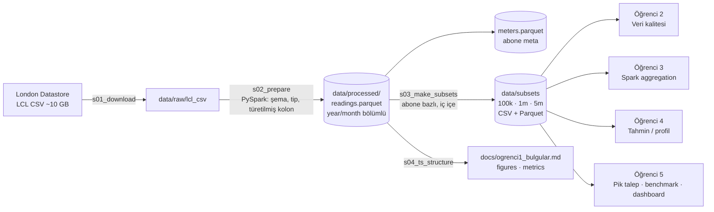

# Proje 5 — Elektrik Tüketimi Büyük Veri Analitiği

**Araştırma sorusu:** Büyük ölçekli akıllı sayaç tüketim verisinden pik talep önceden tahmin edilebilir mi?

## Veri kaynağı

**Low Carbon London (LCL) — SmartMeter Energy Consumption Data in London Households**
UK Power Networks / London Datastore. 5.567 hane, 28.11.2011 – 28.02.2014, yarım saatlik kWh okumaları,
**~167 milyon satır, açılmış hali ~10 GB**. Hanelerin ACORN demografik grubu ve tarife tipi (Std / dinamik ToU) de dosyada yer alır.

- Sayfa: https://data.london.gov.uk/dataset/smartmeter-energy-use-data-in-london-households
- Tam dosya (765 MB zip): `LCL-FullData.zip` · 168 parçalı sürüm (759 MB zip, her biri ~1M satır): `Partitioned LCL Data.zip`
- Site script ile indirmeye izin vermiyor (403). Zip'i tarayıcıdan indirip `data/raw/lcl_partitioned.zip`
  (veya `lcl_full.zip`) olarak koyun; `s01_download.py` dosyayı görünce indirmeyi atlayıp sadece açar.

Ham dosya formatı:

```
LCLid,stdorToU,DateTime,KWH/hh (per half hour) ,Acorn,Acorn_grouped
MAC000002,Std,2012-10-12 00:30:00.0000000, 0 ,ACORN-A,Affluent
```

Veri 167M satırla ödevdeki 5M sınırının çok üstündedir; deneyler için **gerçek verinin iç içe alt kümeleri**
kullanılır. Sentetik ölçekleme (`--upscale`) yalnızca 167M'nin üstündeki sunucu deneyleri ve internetsiz test içindir.

## Mimari



## Klasör yapısı

```
src/common/                 ortak: config (yollar, boyutlar), schema (veri sözleşmesi), spark_session, utils
src/ogrenci1_veri_hazirlama/
  s00_make_synthetic_raw.py LCL formatında sentetik test verisi
  s01_download.py           LCL indirme + açma
  s02_prepare.py            ham CSV -> canonical Parquet (PySpark)
  s03_make_subsets.py       100K / 1M / 5M alt kümeleri, CSV + Parquet, sentetik ölçekleme
  s04_ts_structure.py       zaman serisi yapısı analizi, grafikler, otomatik rapor
notebooks/                  Colab notebook'ları
docs/                       raporlar ve figürler
metrics/                    JSON ölçümler (süre, boyut, istatistik)
```

## Ekip için hızlı başlangıç (Öğrenci 2-5)

Öğrenci 1 hazırlanmış veriyi Drive'da `ebv_data` klasörüyle paylaştı. Veriyi kendiniz indirip işlemenize gerek yok.

1. Drive'da **"Benimle paylaşılanlar"** bölümünde `ebv_data` klasörüne sağ tıklayın, **Düzenle > Drive'ıma kısayol ekle** deyin.
2. Colab'da:

```python
from google.colab import drive
drive.mount('/content/drive')
!git clone https://github.com/<kullanici>/elektrik-buyuk-veri.git   # veya zip'i yükleyip açın
%cd /content/elektrik-buyuk-veri
!pip install -q -r requirements.txt
!ln -sfn /content/drive/MyDrive/ebv_data data     # Drive'daki veri = repodaki data/ klasörü
```

3. Veriyi okuyun:

```python
from src.common.spark_session import get_spark
from src.common.config import subset_path, CANONICAL_PATH
spark = get_spark()
df = spark.read.parquet(str(subset_path("1m", "parquet")))   # "100k" | "1m" | "5m", "csv" | "parquet"
df.printSchema(); df.show(5)
```

Kolonların anlamı aşağıdaki "Ortak veri sözleşmesi" tablosunda. Kendi kodunuzu `src/ogrenciN_<konu>/` klasörüne koyun,
ölçümlerinizi `metrics/`, grafiklerinizi `docs/figures/` altına yazın.

**Önemli:** Drive'daki veriyi silmeyin veya üzerine yazmayın. Kendi çıktılarınızı farklı bir klasöre kaydedin.
Hız ölçümü yapacaksanız veriyi önce Colab diskine kopyalayın (`!cp -r data/subsets /content/subsets_local`).
Drive üzerinden okumak yavaştır ve süre ölçümlerini bozar.

## Kurulum ve çalıştırma

```bash
pip install -r requirements.txt          # Java 11+ gerekir
./run_ogrenci1.sh real                    # gerçek veri, ilk 8 parça (~8M satır)  — dizüstü/Colab
./run_ogrenci1.sh real-full               # gerçek verinin tamamı (~167M satır)   — fakülte sunucusu
./run_ogrenci1.sh synthetic               # internetsiz test
```

Colab için: `notebooks/ogrenci1_colab.ipynb`. Bellek/çekirdek ayarı ortam değişkeniyle:
`EBV_DRIVER_MEMORY=12g EBV_SPARK_CORES=8 EBV_SHUFFLE_PARTITIONS=64 ./run_ogrenci1.sh real-full`

## Ortak veri sözleşmesi (tüm ekip)

Herkes `data/processed/readings.parquet` veya `data/subsets/<boyut>/<format>` okur. Yollar `src/common/config.py`'de.

| Kolon | Tip | Açıklama |
|---|---|---|
| meter_id | string | sayaç / hane kimliği (MAC000002) |
| tariff | string | Std veya ToU |
| ts | timestamp | okuma zamanı, **UTC/GMT, yaz saati düzeltmesi yok** |
| kwh | double | yarım saatlik tüketim; **NULL korunur** (karar Öğrenci 2'de) |
| acorn, acorn_grouped | string | demografik grup |
| date, year, month | date/int | takvim |
| dow | int | 1=Pazartesi … 7=Pazar |
| hour, slot | int | saat, gün içi yarım saat dilimi 0..47 |
| is_weekend | bool | Cumartesi/Pazar |

```python
from src.common.spark_session import get_spark
from src.common.config import subset_path
spark = get_spark()
df = spark.read.parquet(str(subset_path("1m", "parquet")))
```

## Tasarım kararları

1. **Abone bazlı örnekleme:** alt kümeler satır bazlı rastgele örneklemeyle değil, abonelerin tüm serileri alınarak
   oluşturulur. Satır örneklemesi seride delikler açar ve `lag`/pencere hesaplarını bozar.
2. **İç içe kümeler (100K ⊂ 1M ⊂ 5M):** sabit tohumlu hash sırası. Boyutlar arası performans farkı yalnızca
   hacimden gelir, farklı abonelerden değil. Not: bir hane ~30 bin satır olduğundan 100K kümesi az sayıda
   abone içerir; abone sayısına duyarlı analizler (sınıflandırma) 1M/5M veya tam veriyle yapılmalıdır.
3. **Sabit şemayla okuma:** `inferSchema` 167M satırı iki kez tarar; şema `schema.py`'de sabittir.
4. **UTC sabitleme:** makine saat dilimi (Europe/Istanbul) Spark→pandas dönüşümünde yaz saati geçişlerinde
   zaman damgalarını çakıştırıyordu (2012-10-28 01:00 gibi). `spark_session.py` Python ve Spark'ı UTC'ye sabitler.
5. **Ham veriye sadakat:** NULL, tekrar ve ızgara dışı zaman damgaları silinmez, sayılıp raporlanır;
   temizleme kararları Öğrenci 2'nindir.

## Öğrenci katkıları

| Öğrenci | Konu | Kod | Çıktı |
|---|---|---|---|
| 1 | Smart-meter verisini hazırlama, zaman serisi yapısı | `src/ogrenci1_veri_hazirlama/` | canonical Parquet, 100K/1M/5M kümeleri, `docs/ogrenci1_bulgular.md` |
| 2 | Eksik ölçüm, uç değer, veri kalitesi | `src/ogrenci2_.../` | |
| 3 | Spark ile saatlik/günlük/haftalık/abone aggregation | `src/ogrenci3_.../` | |
| 4 | Tüketim tahmini / kullanıcı profili sınıflandırma | `src/ogrenci4_.../` | |
| 5 | Pik talep, performans karşılaştırması, dashboard | `src/ogrenci5_.../` | |

## Lisans / atıf

Veri: UK Power Networks, Low Carbon London projesi, London Datastore üzerinden yayımlanmıştır.
