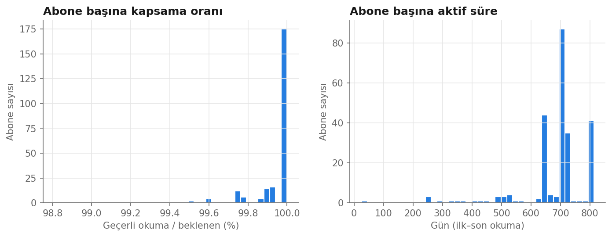
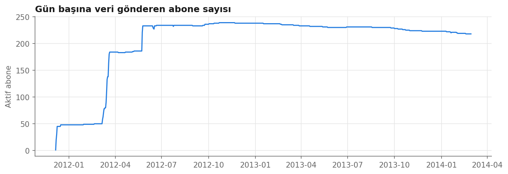
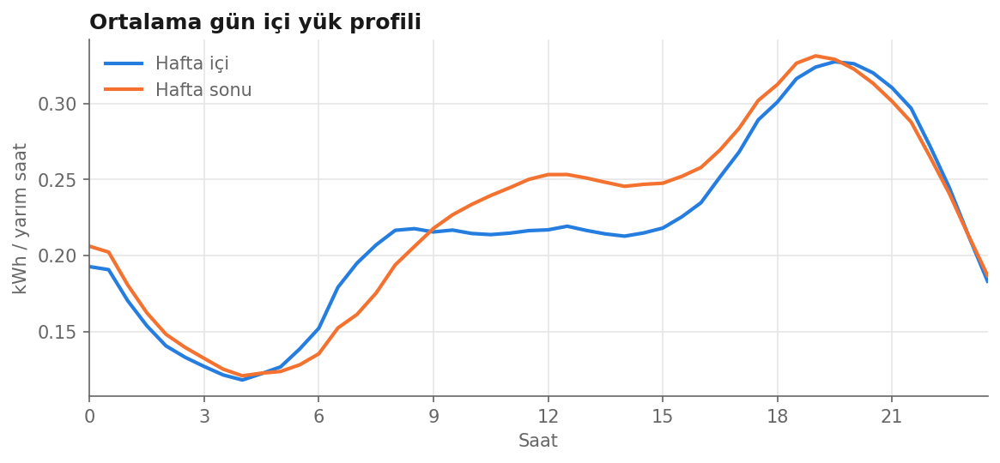
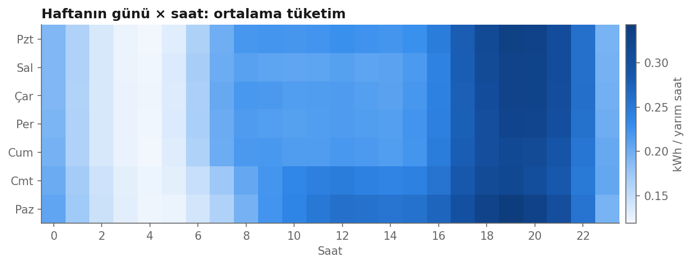
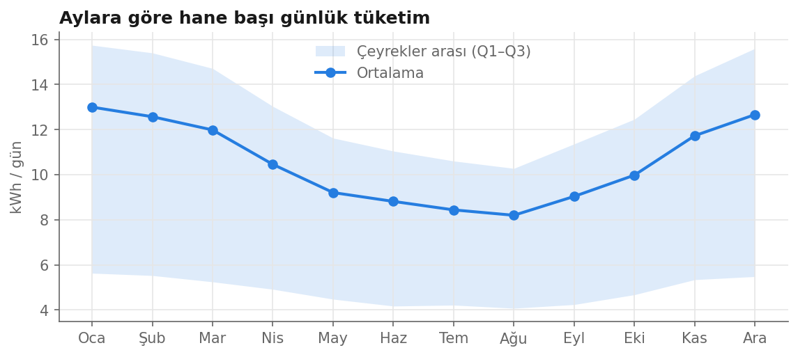
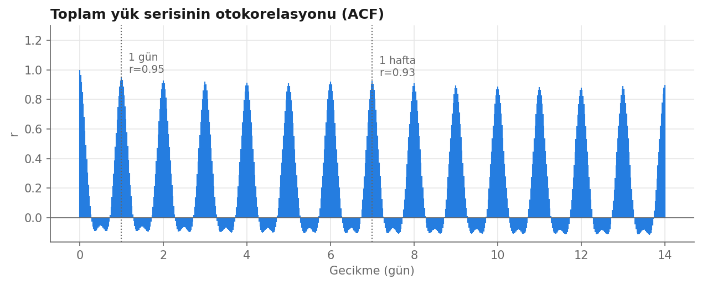
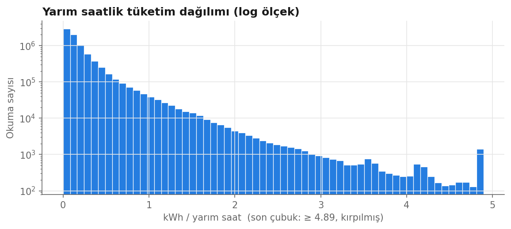
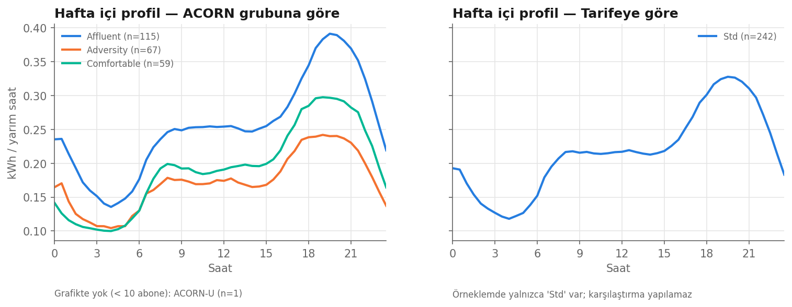

# Öğrenci 1 — Veri Hazırlama ve Zaman Serisi Yapısı: Bulgular

> Otomatik üretildi: 2026-11-27 12:20 · Girdi: **canonical veri (tamamı)**
> Bu dosyadaki sayılar `s04_ts_structure.py` tarafından doldurulur.

## 1. Veri kümesine genel bakış

| Ölçüt | Değer |
|---|---|
| Kayıt (satır) | 8,000,000 |
| Abone (sayaç) | 242 |
| Zaman aralığı | 2011-12-06 13:00:00 → 2014-02-28 00:00:00 |
| kWh değeri boş (NULL) | 238 (%0.003) |
| Tekrarlanan (abone, zaman) satırı | 5,491 |
| Yarım saat ızgarasına oturmayan zaman damgası | 238 |

## 2. Örnekleme düzenliliği (Spark window `lag`)

Her abonenin okumaları zamana göre sıralanıp bir önceki okumayla arasındaki süre hesaplandı.

| Ardışık okuma arası | Adet | Pay |
|---|---|---|
| 30 dk (düzenli) | 7,992,752 | %99.912 |
| 0 (tekrar) | 5,491 | %0.069 |
| 1-2 saat boşluk | 868 | %0.011 |
| ızgara dışı | 476 | %0.006 |
| > 1 gün boşluk | 99 | %0.001 |
| 2-24 saat boşluk | 72 | %0.001 |

Ardışık okumaların **%99.91**'i beklenen 30 dakikalık aralıkta. Toplam **1,039** boşluk
bulundu; medyan boşluk 1.0 saat, en uzun boşluk 4.0 gün.
Boşluklardaki kayıp yarım saat sayısı ≈ 7,053.
**Sonuç:** seri *nominal olarak* düzenli, ama abone düzeyinde eksik dilimler var. Bu yüzden
`lag`/`rolling` tabanlı her öznitelik, gerçek zaman farkına bakılarak hesaplanmalı
(satır sırasına değil). Tekrarlar ve ızgara dışı damgalar Öğrenci 2'ye devredildi.

## 3. Abone kapsaması ve panelin zamanla değişimi

- Ortalama kapsama: **%99.94**; medyan %100.00, en kötü %5'lik dilim %99.74.
- Kapsaması %90'ın altında olan abone: **0**; %99 ve üstü: 241.
- Medyan aktif süre: 712.6 gün.
- Gün başına aktif abone en fazla 239, medyan 231.
  Aktif abone sayısının zirvenin %90'ının üstünde olduğu **dengeli panel dönemi: 2012-05-24 → 2014-02-28**.

**Neden önemli:** Haneler projeye kademeli katıldığı için toplam tüketimin ham toplamı (sum) zamanla
yapay olarak artar. Pik talep analizinde (Öğrenci 5) **abone başına ortalama** veya dengeli panel dönemi
kullanılmalı; aksi halde "talep arttı" sonucu yalnızca abone sayısının artışını yansıtır.

## 4. Periyodik yapı

- Hafta içi pik zamanı **19:30** (0.3276 kWh/yarım saat), en düşük yük 04:00.
  Pik/dip oranı **2.78×**.
- Hafta sonu günlük tüketimi hafta içinin 1.034 katı.
- Sabah yükselişi (yükün gece dibinden gündüz seviyesine %90 ulaştığı an) hafta içi **07:30**,
  hafta sonu **09:30** (+2.0 saat).
  Hafta sonu sabah yükü daha geç başlıyor (geç kalkma). Gün ortası (10:00–16:00) yükü hafta sonu hafta içinin
  1.142 katı (evde geçirilen zaman).
  Akşam piki hafta içi 19:30, hafta sonu 19:00: pik talebi belirleyen davranış iki gün tipinde de akşam.
- Hane başı ortalama günlük tüketim 10.518 kWh. Kış (Ara–Şub) / yaz (Haz–Ağu) oranı: **1.502**.
- Toplam serinin 1 günlük gecikmedeki otokorelasyonu **r = 0.95**; bu güçlü bir günlük periyodiklik demektir. 1 haftalık gecikmede r = 0.926. Haftalık etki günlükten zayıf; yine de `lag_336` özniteliği denenmeli.

**Sonuç:** Seri üç iç içe mevsimsellik taşır: günlük (48 dilim), haftalık (336 dilim) ve yıllık.
Saatlik/günlük/haftalık aggregation'lar (Öğrenci 3) bu periyotlara göre tasarlanmalı; tahmin modelleri
(Öğrenci 4) saat-dilimi, haftanın günü ve ay özniteliklerini mutlaka içermeli.

## 5. Değer dağılımı

| Ortalama | Std | Çarpıklık | Medyan | %99 | %99,9 | Maks | Sıfır payı |
|---|---|---|---|---|---|---|---|
| 0.2190 | 0.3169 | 4.91 | 0.12 | 1.553 | 3.263 | 7.292 | %1.884 |

Dağılım **sağa çarpık** (çarpıklık 4.9): okumaların çoğu düşük taban yükte, az sayıda okuma çok yüksek.
Ortalama medyandan büyük (0.219 > 0.12). Bu nedenle uç değer tespiti (Öğrenci 2) için
ortalama±3σ yerine kuantil/IQR veya log dönüşümü tabanlı yöntemler daha uygun; regresyon modellerinde
log1p(kWh) hedefi denenmeli.

## 6. Demografik gruplar

- **acorn_grouped**: Affluent — 115 abone, ort. 0.2543 kWh/yarım saat, Adversity — 67 abone, ort. 0.1721 kWh/yarım saat, Comfortable — 59 abone, ort. 0.1924 kWh/yarım saat, ACORN-U — 1 abone, ort. 0.303 kWh/yarım saat
- **tariff**: Std — 242 abone, ort. 0.2169 kWh/yarım saat

ACORN grupları arasında ortalama seviye farkı en fazla **1.48×**. Normalize edilmiş (günlük toplamına bölünmüş) profiller arasındaki en düşük korelasyon r = 0.969: gruplar *seviyede* ayrışıyor, *şekilde* neredeyse aynı. Kullanıcı profili sınıflandırmasında (Öğrenci 4) demografik grup tahmini yerine tüketim şekline dayalı kümeleme (normalize 48 dilim) daha anlamlı olur. Grafikte 10'dan az abonesi olan gruplar (ACORN-U) gösterilmedi; tek bir hanenin profili grup ortalaması gibi okunmamalı.

**Tarife:** Bu örneklemdeki abonelerin tamamı **Std** tarifesinde; dinamik (ToU) tarifeli abone yok. Tarife karşılaştırması bu örneklemle yapılamaz. Gerekirse ToU aboneleri içeren LCL parçaları da indirilmeli (tam veride ~1.100 ToU abonesi var).

## 7. Performans notu

| Adım | Süre (sn) |
|---|---|
| overview | 61.31 |
| intervals | 26.381 |
| coverage | 23.655 |
| active | 6.464 |
| profiles | 17.475 |
| acf | 4.424 |
| distribution | 54.513 |
| groups | 11.661 |
