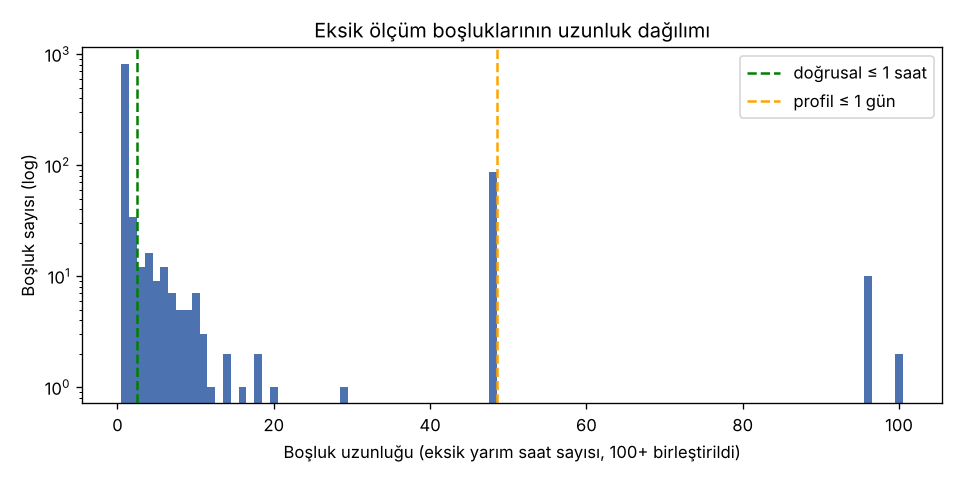
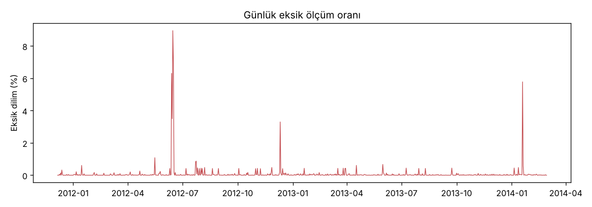
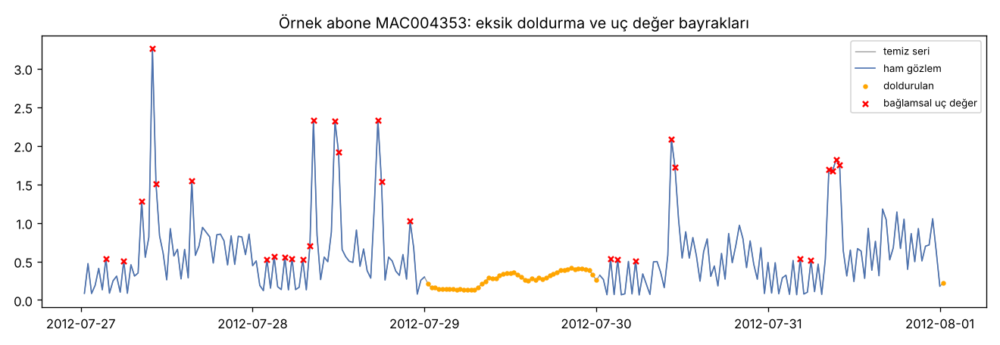
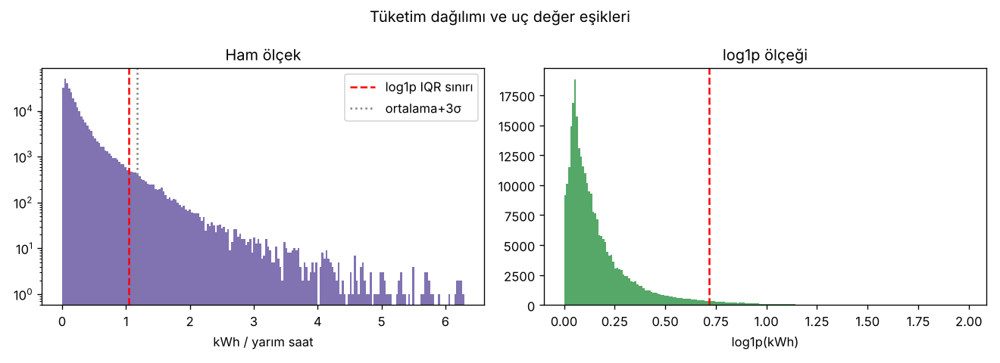
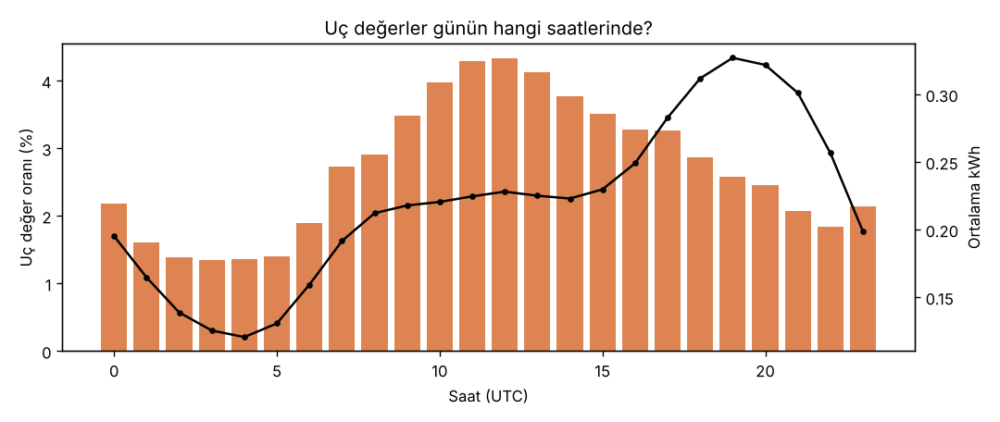
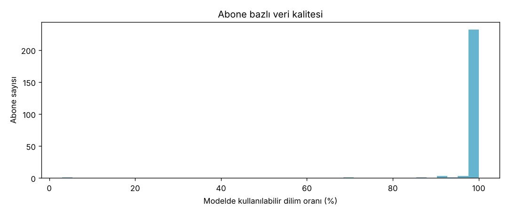

# Öğrenci 2 — Eksik Ölçümler, Uç Değerler ve Veri Kalitesi: Bulgular

> Otomatik üretildi: 2026-11-27 01:07 · Girdi: `data/processed/readings.parquet`
> Bu dosyadaki sayılar `s05_data_quality.py` tarafından doldurulur.

## Özet

| Sorun | Bulgu | Karar |
|---|---|---|
| NULL kWh | 238 satır (%0.003); 238 tanesi ızgara dışı | Satır atılır; dilim eksik sayılıp doldurma adımına girer |
| Izgara dışı zaman damgası | 238 (değer taşıyan: 0) | Atılır |
| Tekrarlanan (abone, zaman) | 5,491 anahtar, 5,491 fazla satır; çelişen değer: 0 | Tek kopya tutulur (çelişki varsa ortalama + `dup_conflict`) |
| Fiziksel geçersiz | negatif 0, > 11.5 kWh 0 | NULL yapılır (`phys_invalid`) |
| Eksik dilim | 1,039 boşluk, 7,053 dilim (%0.088) | Uzunluğa göre doldurma (§3) |
| Global uç değer | 215,583 (%2.697) | Bayrak `out_global`, silinmez |
| Bağlamsal uç değer | 215,980 (%2.702) | Bayrak `out_context`, silinmez |
| ≥ 1 gün kesintisiz 0 | 64,182 dilim, 12 abone | Bayrak `zero_run`, modelden çıkarılır |
| ≥ 6 saat donmuş değer | 3,059 dilim | Bayrak `flat_run`, modelden çıkarılır |

## 1. NULL değerler ve ızgara dışı zaman damgaları

- Toplam 8,000,000 satırda 238 NULL kWh var. Bunların 238 tanesi aynı zamanda
  yarım saat ızgarasına oturmayan zaman damgası taşıyor; ızgara üzerinde olup NULL olan satır: 0.
- NULL'ların %100.0'i en yoğun 2 saatlik pencerede toplanıyor. Aynı anda çok sayıda sayacı
  etkilediği için bu bir hane davranışı değil, **veri toplama sistemi kaynaklı bir olay**:

| Saat | Etkilenen abone | NULL satır |
|---|---|---|
| 2012-12-18 15:00:00 | 227 | 227 |
| 2012-12-19 12:00:00 | 11 | 11 |

**Karar:** Bu satırlar bilgi taşımadığı (değer yok, zaman ızgara dışı) için atılır. Ait oldukları yarım saat dilimi zaten
ızgarada ayrı bir satırla temsil edildiğinden veri kaybı oluşmaz.

## 2. Tekrarlanan kayıtlar

- 5,491 (abone, zaman) anahtarı birden fazla kez geçiyor; bunlar 5,491 fazla satır üretiyor.
- Değerleri birbirinden farklı olan tekrar sayısı: **0**. Yani tekrarların tamamı birebir kopya.
- En sık görüldükleri saat: 00:00 (5,491). Kopyaların gece yarısında
  yoğunlaşması, ham dosyalar birleştirilirken gün/ay sınırındaki satırın iki dosyada da yer aldığını düşündürüyor.

**Karar:** Kopyalardan biri tutulur. Bu adım yapılmazsa Öğrenci 3'ün `sum` aggregation'ları ilgili günleri şişirir.

## 3. Eksik ölçümler ve doldurma stratejisi

Her abone için ilk ve son okuması arasında tam 30 dakikalık ızgara kuruldu (Spark `sequence` + `explode`)
ve gözlemler bu ızgaraya `left join` ile oturtuldu. Toplam ızgara: 8,001,324 dilim.

| Boşluk sınıfı | Boşluk | Eksik dilim | Doldurma yöntemi |
|---|---|---|---|
| Kısa (≤ 2 dilim, ≤ 1 saat) | 856 | 890 | Doğrusal interpolasyon (önceki ve sonraki gözlem) |
| Orta (≤ 48 dilim, ≤ 1 gün) | 170 | 4,723 | Abonenin aynı (haftanın günü, yarım saat) medyanı |
| Uzun (> 1 gün) | 13 | 1,440 | Doldurulmaz, NULL + `long_gap` |

Medyan boşluk 1 dilim, %90'lık 16,
en uzun 192 dilim (4.0 gün).

**Gerekçe:** Öğrenci 1'in ACF analizi (1 dilim gecikmede r ≈ 0.97) kısa vadede serinin çok düzgün olduğunu gösteriyor,
bu yüzden 1 saate kadar doğrusal interpolasyon güvenli. Daha uzun boşluklarda doğrusal çizgi günlük döngüyü (akşam piki)
silerdi; bunun yerine abonenin kendi gün-içi/hafta profili kullanıldı (günlük r ≈ 0.95, haftalık r ≈ 0.93).
1 günden uzun boşluklar uydurma veri üretmemek için boş bırakıldı.

**Sınırlama:** Profil (medyan) ile doldurulan dilimler gerçek seriden daha düzgündür; kısa süreli sıçramaları içermez
(örnek abone grafiğinde turuncu bölüm). Doldurulan dilim oranı çok düşük (%0.088)
olduğu için genel sonuçları etkilemez, ama pik analizi yapılırken `is_imputed = true` dilimler dışarıda bırakılabilir.





## 4. Uç değerler

Öğrenci 1'in bulduğu gibi dağılım çok sağa çarpık. Bu yüzden iki yöntem birlikte kullanıldı:

1. **Global (log1p IQR):** log1p(kWh) üzerinde Q3 + 3.0·IQR → sınır **1.0483 kWh**.
   215,583 okuma (%2.697).
   Kıyas için klasik ortalama + 3σ sınırı 1.1695 kWh olurdu ve 167,899 okuma
   (%2.100) yakalardı. İki sınırın da yaklaşık 1 kWh civarına düşmesi önemli bir şey söylüyor:
   tüm hanelere tek bir eşik uygulamak, yüksek tüketimli hanelerin *normal* akşam tüketimini uç değer sayar,
   düşük tüketimli bir hanenin gerçekten olağandışı sıçramasını ise kaçırır. Bu yüzden global yöntem yalnızca kaba bir
   gösterge olarak tutuldu; asıl karar bağlamsal yönteme dayanıyor.
2. **Bağlamsal (abone × yarım saat robust z):** Her abone ve dilim için medyan ve MAD hesaplandı;
   (kWh − medyan) / (1.4826·max(MAD, 0.05)) > 5.0 olan okumalar bayraklandı: 215,980
   (%2.702). İkisinin kesişimi: 80,583.
   Bu yöntem "bu hane için bu saatte olağandışı" olanı yakalar; az tüketen bir hanenin ani sıçraması da görünür olur.

Bağlamsal uç değerlerin en sık görüldüğü saatler (UTC): 12:00 (14438), 11:00 (14313), 13:00 (13783), 10:00 (13232), 14:00 (12562). Ortalama tüketimin piki ise saat
**19:00**; pik çevresinde (±1 saat) bağlamsal uç değer oranı %2.63.
Yani uç değerler pik çevresinde genel ortalamadan (%2.70) daha sık değil. Akşam piki hanelerin her gün tekrarlanan *düzenli* davranışı olduğu için abonenin kendi medyanı zaten yüksek ve bağlamsal yöntem onu uç değer saymıyor. Gündüz saatlerinde ise medyan düşük olduğundan çamaşır makinesi, fırın, su ısıtıcı gibi kısa süreli yükler olağandışı görünüyor. Pik tahmini açısından bu iyi haber: akşam piki gürültü değil, öğrenilebilir bir örüntü.

**Karar: uç değerler silinmez.** Projenin araştırma sorusu pik talebi tahmin etmek. Yüksek okumaları silmek,
tam olarak tahmin etmeye çalıştığımız olayı veriden çıkarmak olur. Bunun yerine `out_global` / `out_context` bayrakları
eklendi; Öğrenci 4 ve 5 bunları öznitelik olarak veya duyarlılık analizi için kullanabilir.




## 5. Şüpheli diziler (sayaç arızası / boş ev)

- **Kesintisiz sıfır:** ≥ 48 dilim (1 gün) boyunca 0 kWh: 64,182 dilim, 12 abone.
  Toplam sıfır okuma 150,588; bunların büyük kısmı kısa süreli ve normal (gece taban yükü çok düşük haneler).
  Bir gün boyunca hiç tüketim olmaması ise buzdolabı gibi sürekli yükler düşünüldüğünde ya boş ev ya da sayaç/iletişim arızası.
- **Donmuş değer:** ≥ 12 dilim aynı sıfır-olmayan değer: 3,059 dilim.

**Karar:** Bu dilimler `use_for_model = false` olarak işaretlendi. Boş ev dönemleri pik tahmin modelini aşağı çeker.

## 6. Abone bazlı kalite

Verisinin yarısından azı kullanılabilir olan **1 abone** var: MAC000037. Bu abone(ler) neredeyse tamamen sıfır okuma içeriyor (büyük olasılıkla boş ev veya çalışmayan sayaç). **Öneri:** Öğrenci 3-5 bu abone(ler)i analizden tamamen çıkarsın.

En düşük kaliteli 5 abone:

| Abone | Eksik | Bağlamsal uç | Sıfır dizisi | Kullanılabilir |
|---|---|---|---|---|
| MAC000037 | %0.01 | %0.23 | %97.01 | %2.99 |
| MAC004421 | %0.01 | %4.10 | %30.06 | %69.94 |
| MAC004292 | %0.54 | %0.38 | %12.91 | %87.09 |
| MAC004370 | %0.04 | %2.99 | %8.87 | %91.13 |
| MAC004352 | %0.16 | %1.20 | %7.53 | %92.47 |



## 7. Ekip için çıktı: `clean/readings_clean.parquet`

Öğrenci 1'in sözleşmesindeki kolonlara ek olarak:

| Kolon | Açıklama |
|---|---|
| kwh | ham değer (tekrar/geçersiz temizlendi, eksikse NULL) |
| kwh_clean | doldurulmuş değer (uzun boşluklarda NULL) |
| is_imputed | bu dilim dolduruldu mu |
| impute_method | linear / profile / none_long_gap / NULL |
| out_global, out_context | uç değer bayrakları |
| zero_run, flat_run | şüpheli dizi bayrakları |
| quality_flag | tüm bayrakların dikey çizgiyle birleşimi (ör. `imputed_linear\|out_context`), temizse `ok` |
| use_for_model | **önerilen filtre**: `kwh_clean` dolu ve şüpheli dizi değil |

```python
df = spark.read.parquet("outputs/ogrenci2/clean/readings_clean.parquet")
train = df.where("use_for_model")          # Öğrenci 4
daily = df.groupBy("meter_id", "date").agg(F.sum("kwh_clean"))   # Öğrenci 3
```

## 8. Performans

| Adım | Süre (sn) |
|---|---|
| 1_nulls | 6.456 |
| 2_duplicates | 24.355 |
| 3_physical | 26.879 |
| 4_gaps_impute | 34.532 |
| 5_outliers | 73.126 |
| 6_write_clean | 22.576 |
| 7_figures | 12.777 |

### Ölçeklenebilirlik (aynı pipeline, iç içe alt kümeler)

| Alt küme | Satır | Abone | Süre (sn) | Satır/sn |
|---|---|---|---|---|
| 100k | 100,000 | 4 | 12.54 | 7,974 |
| 1m | 1,000,000 | 32 | 32.0 | 31,250 |
| 5m | 5,000,000 | 152 | 90.37 | 55,328 |
